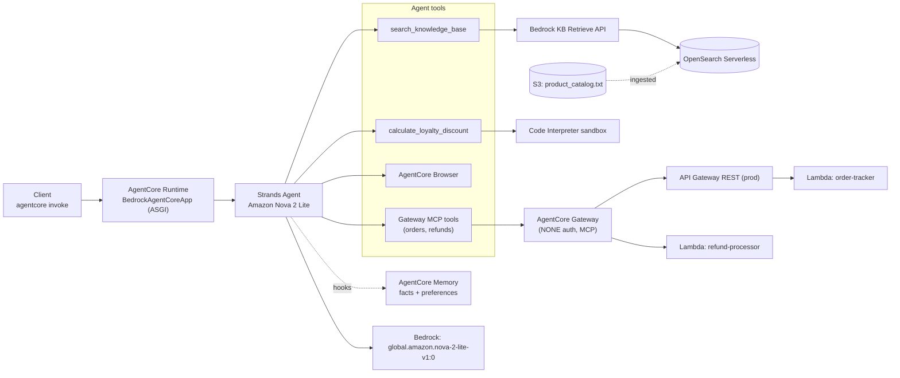
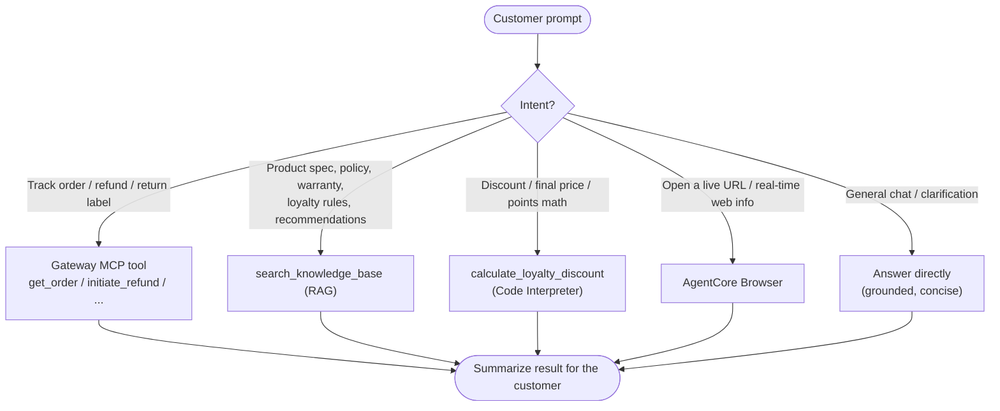
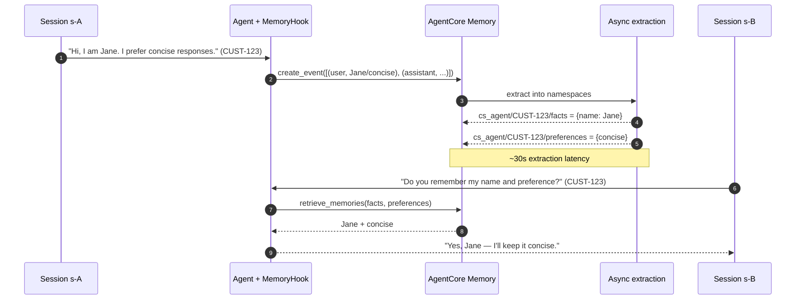
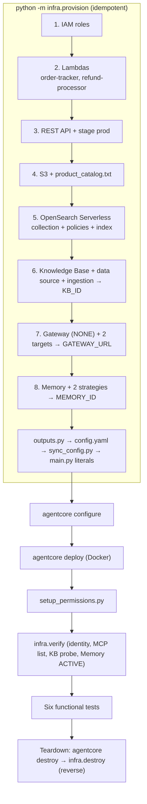

# Architecture — Customer Support AI Agent

Rendered diagrams (Mermaid) and prose for the Amazon Bedrock AgentCore + Strands customer support
agent. Diagrams are text (diff-friendly, no binaries) and render natively on GitHub. They are kept
consistent with the implementation; see `../.kiro/specs/customer-support-agent/design.md` for the
authoritative design and `../DEPLOYMENT.md` for the build log.

---

## (a) System architecture

The deployed agent runs in the AgentCore Runtime and reaches five integrations. Order/refund tools
arrive over MCP from the Gateway; the other capabilities are local tools or AWS calls.



All of the above (except the account-level Code Interpreter/Browser and the model) is provisioned
as code by `starter/infra/`; the Runtime is deployed by the AgentCore toolkit.

---

## (b) Single-invocation request flow

Each `invoke` builds a per-request agent inside the MCP client context, lets memory enrich the
prompt, runs the model/tools, then persists the turn.

```mermaid
sequenceDiagram
    autonumber
    participant C as Client
    participant E as invoke() entrypoint
    participant H as MemoryHook
    participant M as AgentCore Memory
    participant G as MCP Gateway
    participant A as Agent (Nova Lite)
    participant T as Selected tool

    C->>E: {prompt, customer_id, session_id?}
    E->>E: validate prompt; session_id = uuid if absent; log identifiers
    E->>H: MemoryHook(actor, session)
    E->>G: open MCPClient context, list_tools_sync()
    E->>A: Agent(model, [kb, calc, browser, *gateway_tools], hooks=[H], system_prompt)
    A->>H: MessageAddedEvent (user message)
    H->>M: retrieve_memories(facts, preferences, top_k)
    M-->>H: relevant memories
    H-->>A: prepend "Customer Context: ..." to the user message
    A->>T: tool call (if the model decides to)
    T-->>A: tool result
    A-->>E: assistant response
    A->>H: AfterInvocationEvent
    H->>M: create_event([(query, USER), (response, ASSISTANT)])
    E-->>C: first content-block text
```

---

## (c) Tool-routing decision flow

The model routes each prompt to the right capability based on the system prompt and tool
docstrings. Simplified decision view:



---

## (d) Cross-session memory sequence (Test 4)

Two separate sessions, same `customer_id`. Session A writes an interaction; AgentCore extracts
facts/preferences asynchronously; Session B retrieves them.



---

## (e) Deployment / provisioning order (all code)

Resources are created in dependency order by `infra.provision`, then the Runtime via the toolkit;
teardown is the reverse via `agentcore destroy` + `infra.destroy`.



---

## (f) Configuration flow

`config.yaml` is authoritative. Most values are read directly; three are mirrored into `main.py`
literals because `setup_permissions.py` AST-reads them.

```mermaid
flowchart LR
    yaml["config.yaml<br/>(single source of truth)"]
    yaml -->|load_config()| mainpy["main.py runtime values<br/>model_id, rates, prompt path,<br/>GATEWAY_URL, retrieval, timeouts"]
    yaml -->|sync_config.py| lits["main.py literals<br/>REGION, KB_ID, MEMORY_ID"]
    lits -->|AST literal read| perms["setup_permissions.py<br/>→ runtime-role IAM policy"]
    infra["infra/outputs.py"] -->|writes IDs| yaml
    txt["system_prompt.txt"] -->|system_prompt_path| mainpy
```

The idempotent `sync_config.py` only rewrites the three literal lines; `infra.outputs` closes the
loop by writing provisioned IDs back into `config.yaml` so nothing is hand-edited.
