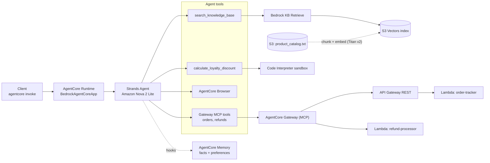

# Customer Support AI Agent — Project Report & Evidence

**Amazon Bedrock AgentCore · Strands SDK · Amazon Nova 2 Lite**

A production-minded AI customer support agent for an e-commerce platform. One conversational
entrypoint handles order tracking, refunds, grounded product/policy Q&A, exact loyalty math, live
web browsing, and cross-session memory — every capability deployed to the cloud and verified
end-to-end.

> ✅ **All six required scenarios pass.**

| | |
|---|---|
| **Runtime** | `cs_support_agent` |
| **ARN** | `…:runtime/cs_support_agent-yMZc9TGr2D` (us-east-1, acct 024333017526) |
| **Model** | `global.amazon.nova-2-lite-v1:0` |
| **Infrastructure** | 100% provisioned as code (boto3) — no console clicks |
| **More** | [Reflection](reflection.md) · [How it works](../docs/HOW_IT_WORKS.md) · [Build log](../DEPLOYMENT.md) |

---

## Results at a glance

| # | Scenario | Capability under test | Result | Evidence |
|---|----------|----------------------|--------|----------|
| T1 | Order tracking | AgentCore Gateway → API Gateway → Lambda (MCP) | ✅ SHIPPED · TRK987654321 · UPS | [screenshot](#t1--order-tracking) |
| T2 | Refund processing | AgentCore Gateway → Lambda target (MCP) | ✅ REF-… · APPROVED · $139.99 · 3–5 days | [screenshot](#t2--refund-processing) |
| T3 | Knowledge Base (RAG) | Bedrock KB Retrieve (S3 Vectors) | ✅ same-day shipping · 15% · priority support | [screenshot](#t3--knowledge-base-rag) |
| T4 | Long-term memory | AgentCore Memory across two sessions | ✅ recalls "Jane" + concise | [screenshot](#t4--cross-session-memory) |
| T5 | Loyalty discount | AgentCore Code Interpreter (sandbox) | ✅ 10% · 4000 pts · **$99.00** · 349 left | [screenshot](#t5--loyalty-discount) |
| T6 | Browser tool | AgentCore Browser (live web) | ✅ live Udacity page title | [screenshot](#t6--browser) |

---

## Architecture

One Strands `Agent`, served by `BedrockAgentCoreApp`, invoked through a single `@app.entrypoint`.
Each request assembles the agent with its tools, a memory hook, and (when reachable) the Gateway's
MCP tools, then lets Nova 2 Lite reason and call tools.



Full diagram set (request flow, tool routing, KB ingestion, memory sequence, provisioning order,
config flow) lives in [`../docs/ARCHITECTURE.md`](../docs/ARCHITECTURE.md).

### How a request flows

1. `invoke(payload)` validates `prompt`, derives `actor_id`/`session_id`.
2. The **MemoryHook** retrieves the customer's facts/preferences and prepends them as context.
3. Nova 2 Lite picks the right tool — or answers directly.
4. The tool runs (KB retrieve, sandbox math, gateway call, or browser fetch) and the model
   composes the reply.
5. The hook saves the turn so a future session can recall it.

---

## Test evidence

Each scenario was run against the deployed agent:

```bash
agentcore invoke '{"prompt": "...", "customer_id": "CUST-123", "session_id": "..."}'
```

---

### T1 — Order Tracking

> **Prompt:** "Can you track order ORD-001?"

**Path:** model → `order-tracker___get_order` → API Gateway → Lambda (over MCP)

**Result:** ✅ Order **SHIPPED** · Wireless Headphones Pro · carrier **UPS** · tracking **TRK987654321** · ETA Nov 8, 2026

The agent pulled live backend data through the Gateway and summarized it cleanly.


---

### T2 — Refund Processing

> **Prompt:** "I want to return my Kindle Paperwhite (ORD-002). Please initiate a refund."

**Path:** model → `refund-processor___initiate_refund` → Lambda target (over MCP)

**Result:** ✅ **Refund ID** issued · status **APPROVED** · amount **$139.99** · credit in **3–5 business days**

The agent looks up the order first, so the refund carries the real amount.

> 💡 **T1 + T2 together** satisfy the MCP rubric: two distinct Gateway-backed tools — one **API Gateway** target, one **Lambda** target — each returning a well-formed response.


---

### T3 — Knowledge Base (RAG)

> **Prompt:** "What are the benefits of the Platinum loyalty tier?"

**Path:** model → `search_knowledge_base` → Bedrock Retrieve over an **S3 Vectors** index (built from `product_catalog.txt`, Titan v2 embeddings)

**Result:** ✅ **free same-day shipping** · **15% discount** · **priority customer support** · correct 5,000-point threshold

Grounded entirely in the catalog — no hallucinated policy.


---

### T4 — Cross-Session Memory

> **Session A:** "Hi, I am Jane. I prefer concise responses."
>
> **Session B (new session, same customer):** "Do you remember my name and communication preference?"

**Path:** `save_support_interaction` writes the turn → AgentCore extracts facts + preferences into per-customer namespaces → `retrieve_customer_context` recalls them next session

**Result:** ✅ Session B replies *"Hello Jane, I remember your name and that you prefer concise responses!"*

Two separate sessions, same `customer_id` — genuine cross-session recall.


---

### T5 — Loyalty Discount

> **Prompt:** "I am a Gold member with 4250 points. Calculate my discount on a $150 standard order."

**Path:** model → `calculate_loyalty_discount` → **Code Interpreter sandbox** (self-contained Python, Pydantic-validated)

**Result:** ✅ exact arithmetic, not an LLM estimate:

| Field | Value |
|-------|-------|
| Tier discount (Gold) | 10% → $11 |
| Points redeemed | 4,000 → $40 |
| Total savings | $51 |
| **Final total** | **$99.00** |
| Points earned | 99 |
| Points remaining | 349 |


---

### T6 — Browser

> **Prompt:** "Go to https://www.udacity.com and tell me the page title."

**Path:** model → AgentCore **Browser** tool → live headless session → page title

**Result:** ✅ *"Learn the Latest Tech Skills; Advance Your Career | Udacity"* — fetched live, not from training data.


---

### Deployment (bonus)

`agentcore deploy` with `direct_code_deploy` packages the code + dependencies and uploads to S3 (no Docker). Endpoint **READY**, observability (CloudWatch Logs + X-Ray) enabled.


---

## Infrastructure as code (no console)

Every AWS resource is created and destroyed by an idempotent boto3 package (`../starter/infra/`);
the Runtime uses the AgentCore toolkit. One command each way:

```bash
python -m infra.provision   # IAM, Lambdas, REST API, S3+KB (S3 Vectors), Gateway+targets, Memory
python -m infra.verify      # identity, 6 MCP tools, KB probe, Memory ACTIVE  → last run 4/4 passed
python -m infra.destroy     # reverse-order teardown
```

Provisioned for this run:

| Resource | Identifier |
|----------|-----------|
| Knowledge Base | `CustomerSupportKB` → `YPXPQVRBJX` (S3 Vectors, Titan v2) |
| Gateway | `CustomerSupportGateway` → `…/mcp`, targets `order-tracker` (API GW) + `refund-processor` (Lambda) |
| Memory | `CustomerSupportMemory-acsKnc57RP` (semantic facts + user preferences) |
| Lambdas | `order-tracker`, `refund-processor` (Python 3.12) |
| REST API | `cs-support-api`, stage `prod` |

**Design choice worth noting:** the KB is backed by **S3 Vectors** instead of OpenSearch
Serverless — simpler to script and no always-on cost (the exact trap the course cleanup warns
about).

---

## Engineering highlights

- **Config as single source of truth** — `config.yaml` drives everything; `sync_config.py` mirrors
  the three literals that `setup_permissions.py` must AST-read, so nothing is hand-edited.
- **Crash-proof startup** — clients built lazily and version-sensitive tools imported on use; a
  bad optional dependency can't stop the runtime from booting (a lesson from a real cold-start
  incident — see the build log).
- **Graceful tools** — each tool catches its own failures and returns a readable message, so one
  flaky integration never sinks a conversation.
- **Structured-output validation** — a Pydantic `DiscountBreakdown` validates the discount result
  before it reaches the user.
- **Reproducible, reversible** — pinned dependencies, idempotent provisioning, one-command teardown.

Where this would go next under real traffic — latency, scaling, and cost — is written up in
[`../docs/PRODUCTION.md`](../docs/PRODUCTION.md).

---

## Reproduce the tests

```bash
cd starter && source .venv/bin/activate && set -a; source ../.env; set +a
agentcore invoke '{"prompt": "Can you track order ORD-001?", "customer_id": "CUST-123", "session_id": "t1"}'
agentcore invoke '{"prompt": "I want to return my Kindle Paperwhite (ORD-002). Please initiate a refund.", "customer_id": "CUST-123", "session_id": "t2"}'
agentcore invoke '{"prompt": "What are the benefits of the Platinum loyalty tier?", "customer_id": "CUST-123", "session_id": "t3"}'
agentcore invoke '{"prompt": "Hi, I am Jane. I prefer concise responses.", "customer_id": "CUST-123", "session_id": "s-A"}'
# wait ~60-90s for memory extraction (eventually consistent), then:
agentcore invoke '{"prompt": "Do you remember my name and communication preference?", "customer_id": "CUST-123", "session_id": "s-B"}'
agentcore invoke '{"prompt": "I am a Gold member with 4250 points. Calculate my discount on a $150 standard order.", "customer_id": "CUST-123", "session_id": "t5"}'
agentcore invoke '{"prompt": "Go to https://www.udacity.com and tell me the page title.", "customer_id": "CUST-123", "session_id": "t6"}'
```

Screenshots use non-secret identifiers only (session/request IDs, account ID); no credentials are
shown.
